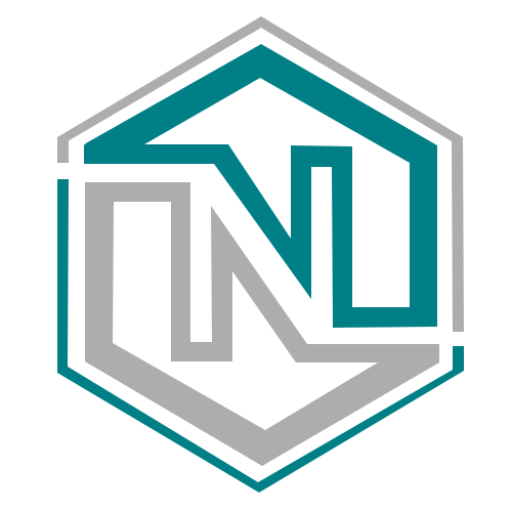

<p align="center">
  
</p>

<h1 align="center">NosCore.Packets</h1>

<p align="center">
  <a href="https://www.nuget.org/packages/NosCore.Packets/"></a>
  <a href="https://github.com/NosCoreIO/NosCore.Packets/actions/workflows/dotnet.yml"></a>
  <a href="https://discord.gg/Eu3ETSw"></a>
  <a href="LICENSE"></a>
</p>

Every NosTale packet as a C# class, and the serializer that turns them into the client's wire format and back. Any
knowledge of field order, separators and sentinels lives here, so the servers only deal with typed packets.
Originally forked from [ChickenAPI.Packets](https://github.com/ChickenAPI/ChickenAPI.Packets).

## Install

```bash
dotnet add package NosCore.Packets
```

## Usage

```csharp
var serializer = new Serializer(new[] { typeof(FailcPacket) });
string wire = serializer.Serialize(new FailcPacket { Type = LoginFailType.Maintenance });
```

The [list of packets](documentation/DocumentationTest.PacketsDocumentation.verified.md) is generated by the tests and
names, for each one, the states in which the client may send it.

## Wire format

Each property carries a `[PacketIndex]` giving its position.

| Type | Null | Value |
|---|---|---|
| `string` | `-` | the text; spaces become `^` when the property sets `EscapeSpaces` or sits inside a nested packet |
| `bool` | `-1` | `1` or `0` |
| number or enum | `-1` | the number |
| `IPacket` | `-1` | the sub-packet |

An optional property (`IsOptional`) writes nothing when it is null.

| The packet contains | Packet separator | Property separator | Discriminator |
|---|---|---|---|
| `IPacket` properties with a `PacketHeader` | space | `^` | `#` |
| `IPacket` properties without a `PacketHeader` | space | space | none |
| a `Host` property | `:` | `-1` | none |
| a list of `IPacket` | space | `.` | none |

## Building

```bash
dotnet build
dotnet test
```

## Contributing

Questions, ideas and pull requests are welcome; most of the discussion happens on [Discord](https://discord.gg/Eu3ETSw).
Any editor that handles .NET 11 works: `dotnet build` and `dotnet test` run on Windows, Linux and macOS.
In Visual Studio, [Roslynator](https://github.com/dotnet/roslynator) and
[ReSharper](https://www.jetbrains.com/resharper/) help keep to the code style.

## Supporting NosCore

NosCore is a spare-time open source project. Sponsoring buys time spent on the emulator and the packages around it,
and gives the **Supporter** role on Discord.

<p>
  <a href="https://github.com/sponsors/0Lucifer0"></a>
  <a href="https://ko-fi.com/A3562BQV"></a>
  <a href="https://www.patreon.com/bePatron?u=6503887"></a>
</p>

Thanks to [Navicat](https://www.navicat.com) for supporting the project.

<a href="https://www.navicat.com"></a>

## Legal

NosCore is an independent, unofficial project for educational use. It is not affiliated with, authorized, maintained,
sponsored or endorsed by Gameforge or any of its affiliates; NosTale is a trademark of Gameforge. Using it may be
against the terms of service of NosTale servers.

Released under the [MIT License](LICENSE).
